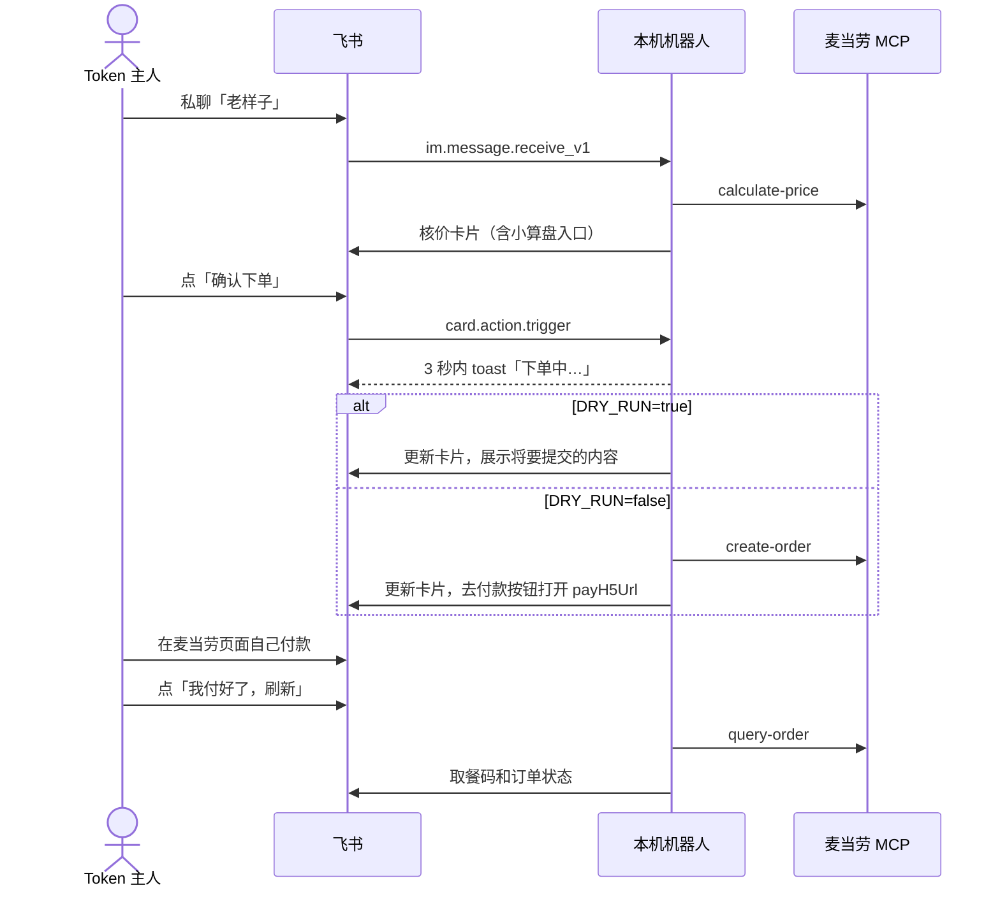
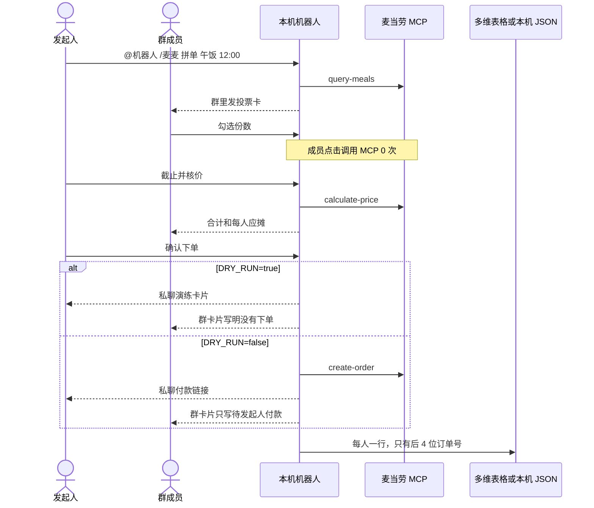
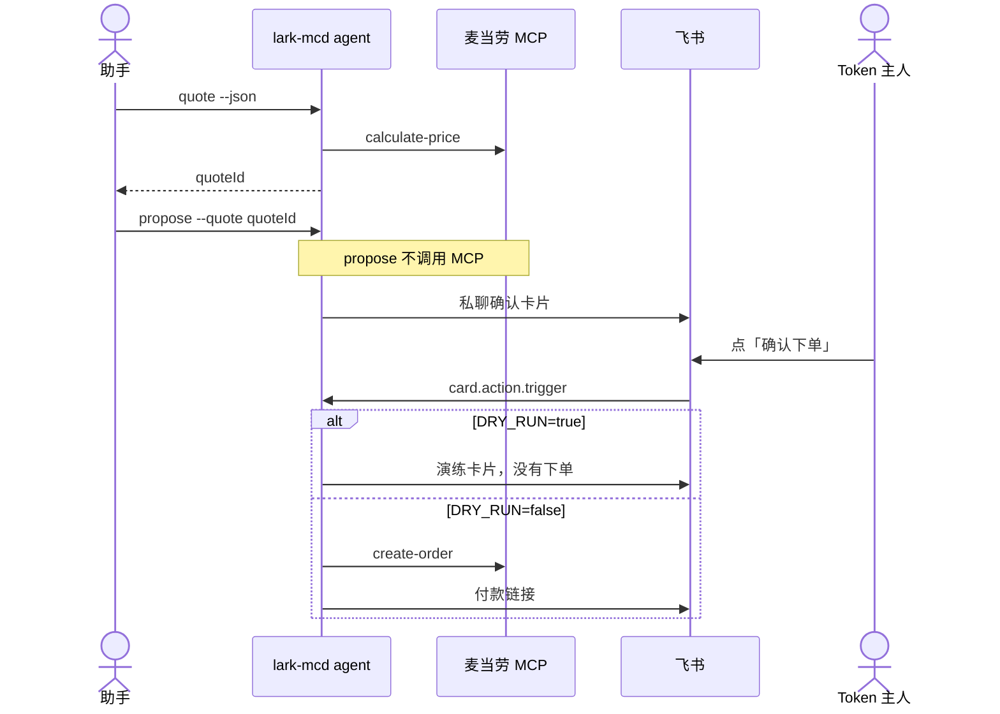

# 麦当劳 MCP 接入说明

## 服务

- 地址：`https://mcp.mcd.cn`
- 传输：Streamable HTTP。服务不返回 `Mcp-Session-Id`，每次请求独立。
- 鉴权：`Authorization: Bearer ${MCD_MCP_TOKEN}`
- 调用：`POST` JSON-RPC `tools/call`。结果在 `result.content[0].text` 里，是一段 Markdown 提示加原始 JSON。解析时定位到 `{"success"`。
- 配置示例：根目录 `mcp-config.example.json`，只有环境变量占位符。机器人进程不读这个文件，只读本机环境变量。

这一版只做到店自取：`orderType=1`、`beType=1`，不传 `beCode`。

## 用到的工具

| 用户动作 | 工具 | 次数上限 |
| --- | --- | --- |
| `/麦麦 门店 城市 关键词` | `query-nearby-stores`（`beType=1`，`searchType=2`） | 1 |
| 点「选这家」 | 不调用，只写入本机状态 | 0 |
| 私聊「老样子」，本机已有配方 | `calculate-price` | 1（预算 2） |
| 私聊「老样子」，本机没有配方 | `order-list`，有已完成订单再 `calculate-price`；没有则改为 `query-meals`，等下一次点击再核价 | 2 |
| 点「换一换」 | 菜单不在内存里时 `query-meals`，然后 `calculate-price` | 2 |
| 点「算一算」 | `calculate-price`（带 `withOrder`）；需要频率而又没填时再 `order-list`。菜单不在内存里时先 `query-meals` | 2 |
| 点「确认下单」 | `create-order`。演练模式不调用 | 1 |
| 点「我付好了，刷新」 | `query-order`。同一订单 10 秒内一次 | 1 |
| 点「确认取消」 | `cancel-order`。演练模式不调用 | 1 |
| 发起人在群里发送 `/麦麦 拼单 午饭 12:00` | `query-meals`。同一门店 10 分钟内已有菜单则不再调用 | 1 |
| 群成员勾选、改份数、点「我不吃了」 | 不调用 | 0 |
| 发起人点「截止并核价」 | `calculate-price` | 1 |
| 发起人点「确认下单（发起人）」 | `create-order`。走和私聊相同的确认守卫。演练模式不调用 | 1 |
| 发起人点「刷新取餐码」 | `query-order`。同一订单 10 秒内一次 | 1 |
| 写入 AA 台账 | 不调用 MCP。飞书多维表格或本机 JSON | 0 |

没有实现、也不会调用：`auto-bind-coupons`、`draw-lottery`、`mall-create-order`、`party-order-create`、`delivery-create-address`。

`create-order` 不带 `withOrder`。小算盘只比较价格，不购买会员卡。`query-meals` 里的 `withOrder.specId` 会映射成核价参数 `membershipSpecId`。这个映射还没拿真实下单核对过。

## 私聊时序

付款按钮是 `open_url`，不走回调。卡片回传值只有动作名、会话 ID 和版本号，不放 Token，也不放完整价格。

## 群拼单时序

一场拼单对应发起人已经保存的一家店，以及指令里的一个时段。时段只记在这场投票上，用来限制「一场一个时段」。这一版按到店即时单核价和下单，不传 `reservationDate`。总份数上限 10。

群卡片不放 `payH5Url`。付款按钮只出现在发起人的私聊里。非发起人点「截止并核价」或「确认下单」时，守卫和回调都会拒绝，MCP 次数保持不变。

分摊用整数分。每个人的原始小计来自 `calculate-price` 的 `productList.subtotal`，同一商品按份数拆开。优惠、餐具和实付差额按原始小计比例分摊，除不尽的分加到发起人身上。所有人应摊之和等于这笔订单的实付。演练模式还没有实付，台账订单号写成「演练」。真实下单后只保留订单号后 4 位。手机号、地址、取餐码和完整订单号不进台账。

多维表格使用 `BITABLE_APP_TOKEN` 和 `BITABLE_TABLE_ID`。两个都没填时写 `~/.lark-mcd/ledger.json`。写入表格失败时同样退回这个文件。

## Agent 入口

飞书卡片机器人仍是唯一会调用 `create-order` / `cancel-order` 的路径。`lark-mcd agent` 只做只读查询，以及一次不调用 MCP 的 `propose`。安装和宿主配置见 [docs/agents.md](docs/agents.md)。

| 命令 | 工具 | 是否写入 |
| --- | --- | --- |
| `agent stores` | `query-nearby-stores` | 否 |
| `agent menu` | `query-meals`（本机缓存 5 分钟） | 否 |
| `agent quote` | `calculate-price` | 否，报价落在本机，5 分钟有效 |
| `agent status` | `order-list` 或 `query-order` | 否 |
| `agent propose` | 不调用 MCP | 否，只给 Token 主人发飞书确认卡片 |

没有 `order` / `cancel` 子命令。触发器 `kind` 为 `agent` 时，守卫对 `create-order` 和 `cancel-order` 直接返回 `TOOL_DISABLED`。Agent 还有本机限速：每分钟 6 次、每天 60 次（北京时间）。需要环境变量 `LARK_MCD_AGENT=1`，并且不要放进定时任务或心跳。

不要把 Token 配进宿主的 MCP 连接器去直连 `https://mcp.mcd.cn`。那会绕过上表的守卫。`mcp-config.example.json` 只给本机机器人以外的参考客户端，Agent 入口不使用它。

## 守卫

`McpClient.call()` 必须带上 `trigger`：`kind`（消息、卡片或 `agent`）、`eventId`、`operatorOpenId`、`action`。

下面任一情况都会在发请求前抛错：

- 没有 trigger
- `operatorOpenId` 不是 `OWNER_OPEN_ID`
- 工具不在白名单里
- `kind` 是 `agent`，并且工具是 `create-order` 或 `cancel-order`（`TOOL_DISABLED`）
- 同一次点击超过上表的次数
- 写操作不是卡片点击，或草稿还没核价
- `DRY_RUN` 不是字符串 `false`
- 同一草稿已经创建过订单
- 同一订单 10 秒内再次 `query-order`

默认 `DRY_RUN=true`。只有环境变量精确等于 `false` 才关闭。

菜单缓存在进程内存里，不落盘，也不随仓库公开整份菜单。`fixtures/` 里每个菜单不超过 10 个商品，门店名和编号都是演示值。

## 业务价值

上班时不用打开 App 翻最近一单。飞书里说「老样子」，先看到实时核价，再自己决定付不付款。会员卡小算盘把「这单加购后餐品能省多少、按每周几次大约多久回本」算出来，买不买仍由你在麦当劳 App 里决定。

价格和订单状态以麦当劳 App 显示为准。
